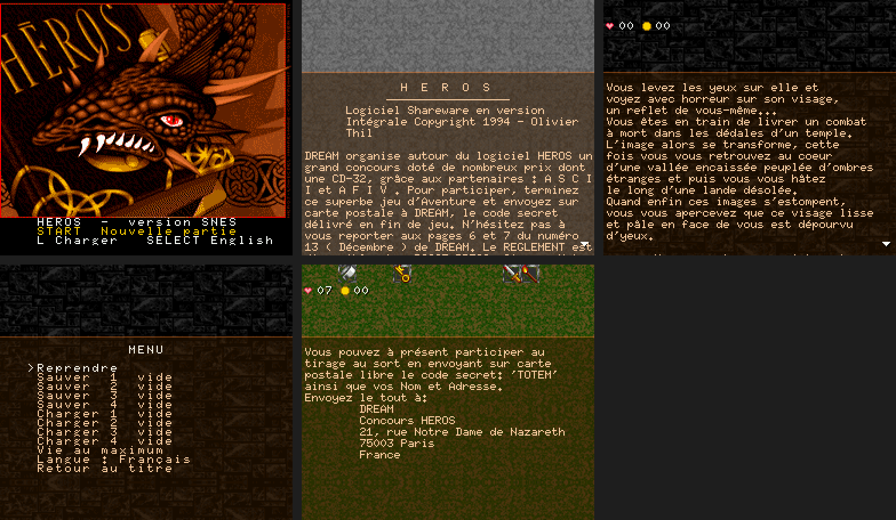

# HEROS sur Super Nintendo

Le jeu **complet** (212 scènes, textes FR + EN, 32 musiques, 4 sauvegardes) en ROM SNES :
`heros_snes.sfc` (LoROM 2 Mo, SRAM 8 Ko à batterie). Testé dans snes9x ; **pas encore sur console réelle**.

## Commandes

| Touche | Action |
|---|---|
| A / B / X / Y | choix F1 (rouge) / F2 (jaune) / F3 (bleu) / F4 (vert) — les pastilles de couleur sont affichées devant chaque choix |
| L ou R | choix F5 (gris) |
| Haut / Bas | fait défiler le texte (Gauche / Droite : une demi-page) |
| SELECT | retour en arrière (le « B » de la version PC), jusqu'à 127 pas |
| START | menu : reprendre, sauver 1-4, charger 1-4, vie au maximum, langue, retour au titre |
| Titre : START / L / SELECT | nouvelle partie / charger / langue FR-EN |

Les sauvegardes (4 emplacements) contiennent tout l'historique : le retour arrière marche après un chargement.
Le HUD (haut de l'écran) montre les objets portés, la vie et l'or.

## Ce qui est fidèle, ce qui est adapté

* Moteur : scènes, liens, routines (83), drapeaux, vie, or, mort → « Vallée de la Mort » : portage exact de la version web.
  Vérifié par comparaison avec un moteur de référence Python : le chemin le plus court (80 choix) jusqu'au code secret `TOTEM`
  et ~1700 choix aléatoires (retours arrière, boutons invalides, morts, sorties) donnent le même état (scène, W, L, vie, or) à chaque pas.
* Musique : les 32 morceaux du module Amiga sont rejoués par le SPC700 (pilote maison, échantillons BRR), un morceau par ambiance.
* Texte : police 6x10 d'origine (42 colonnes), pré-rendue en tuiles dédupliquées (20 000 tuiles uniques). Accents composés à la main.
* Décors : les textures des scènes, réduites à 16 couleurs (le panneau de texte est translucide, par calcul de couleur du PPU).
  Écran-titre : le dragon.
* Adapté : les pages d'introduction TIN1-4 (la page « règle du jeu » parle de la manette).
* **Pas repris** : la carte (touche M), l'écran de triche, l'option son, la fresque de la scène TT20 (le décor est une simple texture).

## Reconstruire

Pré-requis : Python 3 + Pillow + numpy, [WLA-DX](https://github.com/vhelin/wla-dx) (`wla-65816`, `wlalink`) dans le PATH,
et le dépôt `amiga_heros` complet (ce dossier est à sa racine : on lit `jeu/img/*.png` et `amiga/DataHeros-*`).

    ./build.sh          # -> heros_snes.sfc (reproductible)

* `src/main.s` : le moteur 65816 (≈2600 lignes). `src/conv.py` + `textconv.py` + `fontk.py` : convertisseur de données
  (tuiles, scènes, routines en bytecode, décors, sprites, bancs ROM). `src/mkdata_json.py` : extrait `data/data.json` de `jeu/data.js`.
* `spc/` : pilote SPC700 (`pilote.s`), convertisseur musique (`musique.py`) ; les binaires `spc_a.bin`/`spc_b.bin` sont déjà construits
  (`python3 musique.py heros_tout.mod ambiances_par_scene.txt .` puis `wla-spc700`, voir le dépôt).
* `tests/` : moteur de référence, pilote libretro (snes9x), scripts de test (`randtest.py`, `cmp.py`, `scenetest.py`).

## Organisation de la ROM

Banque 0 : code + tables (scènes, palettes, routines, chaînes). Banques 1-2 : image SPC700 (47 694 o).
Banques 3-12 : réserve de tuiles de texte (2 bpp). Puis blocs de texte (carte de tuiles compressée par plages vides),
39 décors (4 bpp, 256x64), dragon, sprites (16 icônes d'objets, pastilles de boutons, chiffres), police 8x8 des menus.
Écran : mode 1 — BG1 décor, BG2 panneau (translucide), BG3 texte, sprites pour HUD/pastilles ; fenêtre par HDMA pour masquer le texte au-dessus du panneau.
